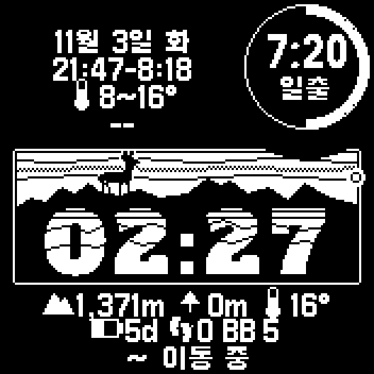
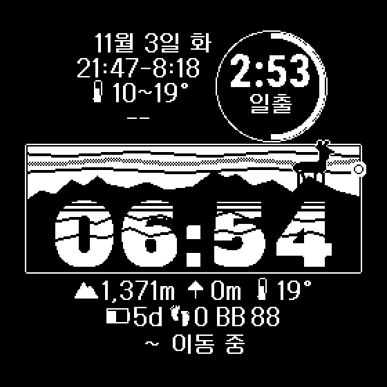

# Backpack Face — 백패킹 워치 페이스 (Instinct 3 Solar · Fenix 7X)

산에서 며칠씩 폰 없이 다녀도 필요한 정보가 한눈에 들어오도록 만든 흑백 워치 페이스.
파타고니아 로고를 오마주한 "파타고라니" 배너(산맥 + 고라니) 위에 시각을 얹었다.

 

## 지원 기기

| 기기 | 기기 ID | 화면 | 비고 |
|---|---|---|---|
| Instinct 3 Solar 45mm·50mm | `instinct3solar45mm` | 176×176 흑백, 서브스크린 | 기준 디자인 |
| fēnix 7X / 7X Solar / 7X Sapphire Solar | `fenix7x` | 280×280 원형 | 같은 구성을 1.5배로 다시 그림. 서브스크린 자리에 원을 직접 그림 |

## 화면 구성

| 위치 | 내용 |
|---|---|
| 좌상단 | 날짜(`11월 3일 화`) + 정보 칸 3줄 (기본: 일출·일몰 시각 / 오늘 기온 범위 / 지명) |
| 우상단 서브스크린 | 다음 일몰(밤이면 일출)까지 남은 시간. **둘레 링 = 지금 태양광 충전 세기** (해를 향하면 바로 차오름) |
| 배너 | 하늘을 가로지르는 해 = 일출~일몰 진행. 고라니는 한 시간마다 능선 위 다른 자리로 옮겨 해 쪽을 바라본다 |
| 시각 | 흰 슬랩 세리프 숫자, 숫자 안에 겹친 능선(산그리메) |
| 아래 첫 줄 | 정보 칸 3개 (기본: 고도 / 오늘 오른 높이 / 기온) |
| 아래 둘째 줄 | 정보 칸 3개 (기본: 배터리 남은 일수 / 걸음 수 / 바디 배터리) |
| 맨 아래 | 3시간 기압 추세로 본 날씨 전망 |

글자는 시계 언어와 관계없이 내장 한글 비트맵 폰트(갈무리11)로 그린다. 단위는 m·°C.

### 정보 칸 (9칸, 폰에서 변경)
Garmin Connect 앱 → 워치 페이스 설정에서 칸마다 고른다.

없음 · 고도 · 오늘 오른 높이 · 배터리 남은 일수(`5d`) · 바디 배터리(`BB`) · 일출·일몰 시각 ·
걸음 수 · 오늘 이동 거리 · 심박 · 기온 · 알림 수 · 오늘 최저~최고 기온 · 지명

### 날씨 전망 (맨 아래 줄)
3시간 기압 변화로 판단한다.

| 변화 | 표시 |
|---|---|
| −3 hPa 이하 | **폭풍 주의** (반전 표시) |
| −1 hPa 이하 | 흐려짐 (기온 0°C 이하면 눈 아이콘) |
| ±1 hPa 미만 | 유지 |
| +1 hPa 이상 | 맑아짐 |
| 판단 불가 | `측정 중`(기록 2시간 미만) · `이동 중` · `기압계 없음` |

시계 고도도 기압으로 재므로, 고도가 50m 넘게 바뀌면 걸음 수로 실제 이동 여부를 본다.
3시간에 500보 이상 걸었거나 150m 넘게 바뀌었으면 "이동 중"으로 보고 전망을 내지 않는다.

## 폰 없이 동작하는 방식

- **위치**: 폰 날씨 관측 위치 → 활동 GPS → 마지막 저장값 순으로 쓴다. 5km 넘게 바뀔 때만 저장한다.
- **일출·일몰**: 기기 안에서 계산(오차 1~2분). 날짜가 바뀔 때, 그리고 1시간마다 위치를 확인해 5km 넘게 이동했을 때 다시 계산.
- **지명**: 시계가 폰 날씨의 지명을 주지 않아 앱에 넣은 표(전국 시·군·구 256곳 + 100대 명산)에서 가장 가까운 곳을 찾는다.
  정상 3km 안이면 산 이름, 가장 가까운 시·군·구가 80km보다 멀면(국외) `--`. 10분마다 보고 300m 넘게 옮겼을 때만 다시 찾는다.
- **기온**: 폰에서 받은 날씨가 3시간 넘게 오래되면 쓰지 않고 `--`로 표시 (산에서 연결이 끊긴 뒤 오래된 값을 믿지 않도록).

## 소스

| 파일 | 역할 |
|---|---|
| `source/InstinctFaceView.mc` | 화면 그리기, 서브스크린 링 갱신, 기압 추세 |
| `source/Slots.mc` | 정보 칸 종류·기본 배치·값 포맷, 날씨·지명 캐시 |
| `source/SunTimes.mc` | 위치 확보, 일출·일몰 계산 |
| `source/Places.mc` | 위치 → 가장 가까운 지명 |
| `source/Icons.mc` | 작은 벡터 아이콘 (산, 화살표, 해, 번개 등) |
| `source-176/`, `source-280/` | 화면별 배치: `Layout.mc`(글자·칸·서브스크린 좌표), `Banner.mc`(**생성 파일**) |
| `source/PlaceChunks.mc` | **생성 파일** — 직접 고치지 말 것 |
| `resources/` | 화면 공통: 폰 설정 화면(칸 선택)과 기본값, 문자열, 지명표 |
| `resources-176/`, `resources-280/` | 화면별 비트맵(배너·숫자·고라니·이모지)과 한글 폰트 |

배너·숫자·이모지·한글 폰트·지명표는 [`design/`](../design/README.md)의 스크립트로 만든다.

## 빌드·설치

저장소 루트에서:

```sh
./build.sh InstinctFace instinct3solar45mm run      # 시뮬레이터
./build.sh InstinctFace instinct3solar45mm install  # USB로 연결한 시계에 설치
./build.sh InstinctFace fenix7x run                 # Fenix 7X 시뮬레이터
./build.sh InstinctFace fenix7x install             # Fenix 7X에 설치
```

시뮬레이터에서 지명·일출·일몰을 보려면 Settings → Set Position으로 위치를 넣는다.
