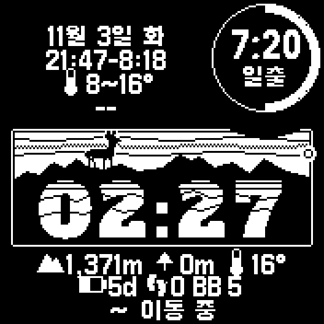

# GM — Garmin Instinct 3 Solar 개인 앱 모음

Connect IQ 프로젝트. 대상 기기 ID `instinct3solar45mm` (45mm·50mm 공용).



| 폴더 | 종류 | 내용 |
|---|---|---|
| `InstinctFace/` | 워치 페이스 | 백패킹용. 능선 숫자, 고라니 배너, 일출·일몰, 가까운 지명, 태양광 링 ([README](InstinctFace/README.md)) |
| `SunsetMargin/` | 데이터 필드 | 일몰 전 도착 여유 시간 ([README](SunsetMargin/README.md)) |
| `InstinctApp/` | 워치 앱 | 기본 틀 |
| `design/` | 리소스 생성 | 숫자·배너·이모지·한글 폰트·지명표를 만드는 Python 스크립트와 원본 폰트 |

## 준비
- Connect IQ SDK (SDK Manager에서 Instinct 3 Solar 기기 설치), OpenJDK 17
- 개발자 키: `.devkey/developer_key.der` (git에 없음. 별도 백업본을 이 위치에 둔다)
- 시계 직접 설치: `brew install libmtp`

## 빌드
```sh
./build.sh InstinctFace                          # 빌드 → bin/
./build.sh InstinctFace instinct3solar45mm run     # 시뮬레이터 실행
./build.sh InstinctFace instinct3solar45mm release # 릴리스 빌드
./build.sh InstinctFace instinct3solar45mm install # 릴리스 빌드 후 USB로 시계에 설치
```

## 리소스 다시 만들기
배너·숫자·이모지·한글 폰트·지명표는 `design/`의 스크립트로 만든다. [design/README.md](design/README.md) 참고.

## 라이선스
코드는 [MIT](LICENSE). 아래는 각자의 라이선스를 따른다.
- 폰트(`design/fonts/`)와 갈무리에서 만든 한글 비트맵 폰트(`InstinctFace/resources/fonts/`): SIL OFL 1.1
- 지명 데이터(`design/places/`)와 이를 변환한 지명표: © OpenStreetMap contributors (ODbL), Wikidata (CC0), 위키백과 (CC BY-SA)
